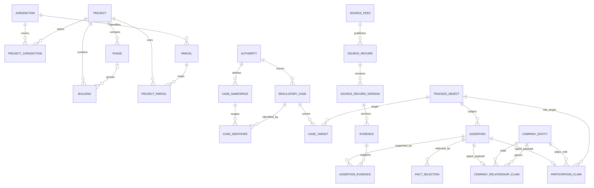

# Data-Center Permit Intelligence: Database Design

An evidence-backed PostgreSQL reference model for tracking U.S. data-center projects, regulatory cases, and corporate ownership across jurisdictions. This package complements the AI Capex Boom Monitor; it does **not** change the monitor’s financial book, weekly contract, application, or deployment configuration.

**Status:** Design and locally tested schema. No live collectors, project records, production database, alerts, or deployment are included.

## Start here

Read the [full data-model specification](Data_Model_Design.md) and [validation summary](Validation_Summary.md). The model separates physical campuses/buildings/parcels, authority-scoped regulatory cases, legal entities and their site roles, and evidenced parent-control relationships. Bitemporal selections preserve both real-world effective dates and when the tracker learned a fact.



## Files

| File | Purpose |
| --- | --- |
| [Data-model specification](Data_Model_Design.md) | Table grains, identities, temporal semantics, source-update contracts, and rollout boundaries |
| [PostgreSQL schema](001_schema.sql) | Bootstrap DDL, integrity triggers, indexes, views, and parent traversal |
| [Regression tests](002_tests.sql) | 37 rollback-only tests using clearly synthetic fixtures |
| [Example queries](003_queries.sql) | Seven sections covering projects, permits, parent chains, capacity, capital, evidence, and source health |
| [Data dictionary](data_dictionary.csv) | Catalog-derived definitions for 49 tables and 296 columns |
| [Editable ER diagram](model_overview.mmd) | Mermaid source for the selected-relationship overview |
| [Validation summary](Validation_Summary.md) | Tested behaviors and explicit production-readiness gaps |
| [Original test transcript](test_results.log) | Results from the local PostgreSQL 16 validation |
| [Checksums](MANIFEST.sha256) | SHA-256 hashes of the original package files |
| [Downloadable package](Data_Center_Database_Design_Package.zip) | Original design bundle, including its internal checksum manifest |

## Validate locally

Use a **new, empty PostgreSQL 16+ database** and an account allowed to install `btree_gist`:

```bash
cd docs/data-center-permit-intelligence
sha256sum -c MANIFEST.sha256
psql -X -v ON_ERROR_STOP=1 -d YOUR_NEW_DATABASE -f 001_schema.sql
psql -X -v ON_ERROR_STOP=1 -d YOUR_NEW_DATABASE -f 002_tests.sql
psql -X -v ON_ERROR_STOP=1 -d YOUR_NEW_DATABASE -f 003_queries.sql
```

The bootstrap creates the `dc` schema. It is **not idempotent and is not an upgrade migration**; do not run it against an existing populated registry. Test fixtures are rolled back. Replace illustrative query IDs and dated cutoffs before querying real records.

## Interpretation safeguards

A permit is not a project, an applicant is not automatically an owner, and an equity owner is not automatically a controlling parent. A terminal known parent chain is not proof that the ultimate parent has been identified. Source failures and missing records do not prove project cancellation.

Permit valuations, site investments, corporate capex commitments, financing, acquisitions, and leases are separate disclosures—not a universally additive capital total. IT load, utility service, facility load, and generator nameplate are distinct metrics. This package does not replace or reconcile the repository’s existing financial figures.

Production use requires approved source access, controlled/server-stamped write and review workflows, role permissions, adapter-specific locking/checkpoint semantics, application validation, and further concurrency/security testing. See the specification for full boundaries.
